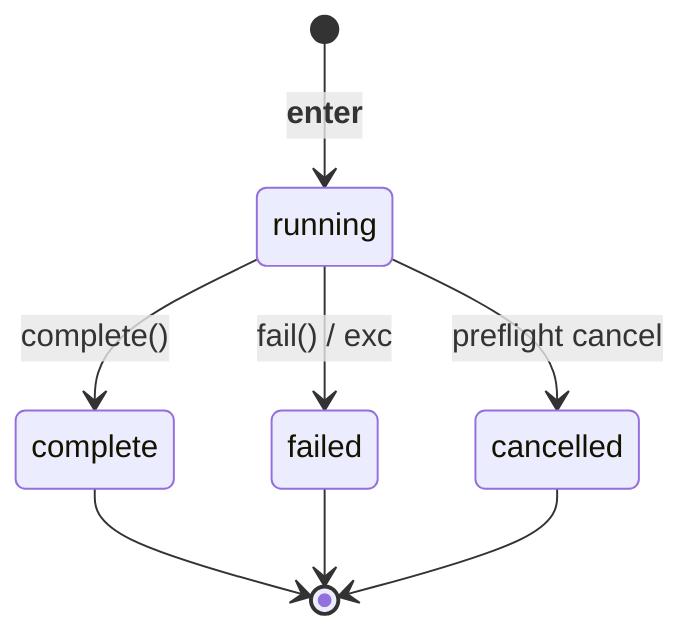
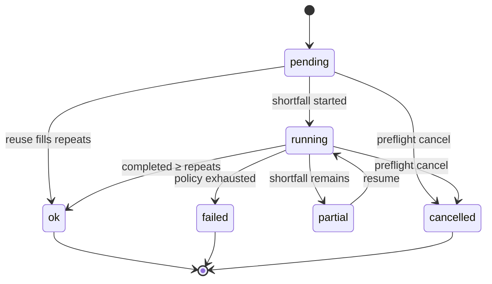
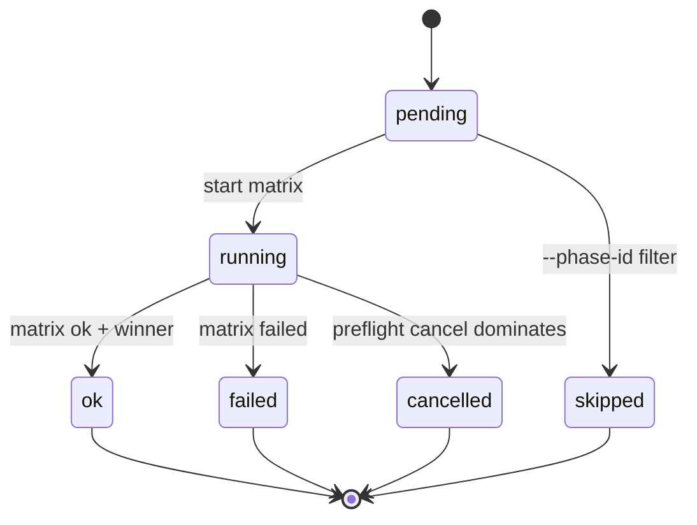
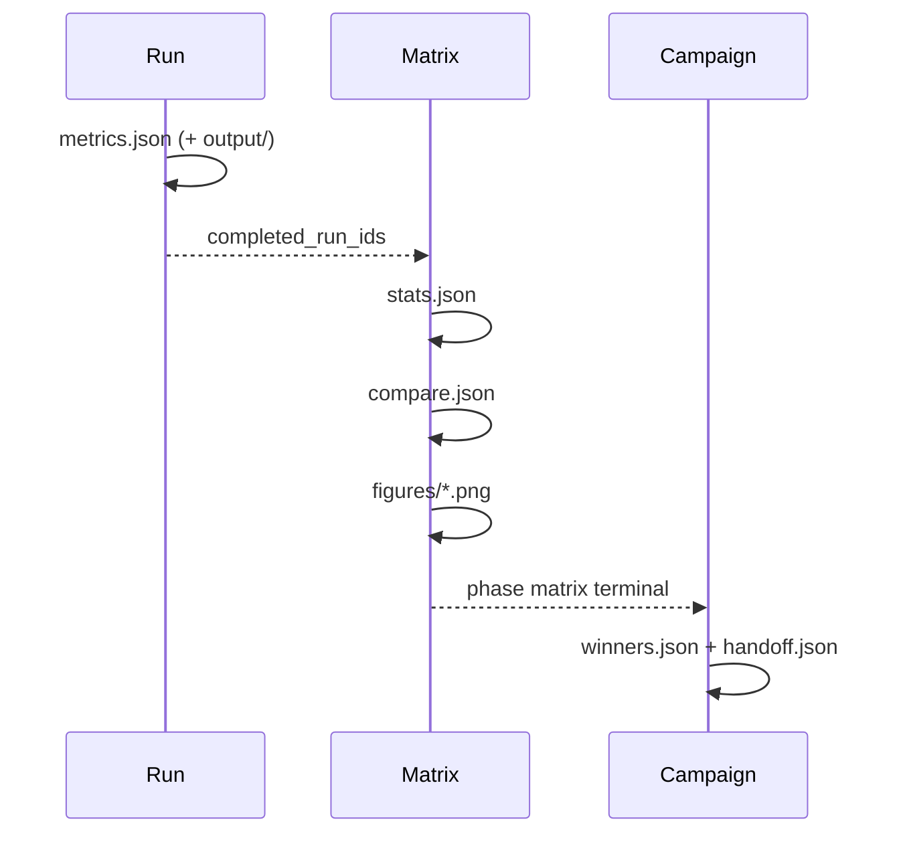

# Artifact schemas

On-disk result JSON shapes (not a Python module). Writers: `fs.py` for metadata/metrics/manifest IO; `reporting/` for matrix `stats.json` / `compare.json` / figures.

All structured artifacts are JSON. Timestamps are UTC ISO-8601 strings. Paths in JSON are relative to the result directory unless noted.

Result stamp format: `YYYYMMDD_HHMMSS_<stem>` (UTC). The stamp is the result directory basename and the `metadata.id` / `*_id` value.

## Status enums

Lifecycle detail and driver algorithms: [Lifecycle](lifecycle.md).

### Run (`metadata.json` → `status`)



| Status | Meaning |
|---|---|
| `running` | Context entered; body not finished |
| `complete` | `complete()` succeeded |
| `failed` | `fail()` or uncaught exception from runner |
| `cancelled` | Preflight cancelled before launch |

Terminal: `complete` | `failed` | `cancelled`.

### Matrix / campaign layer (`metadata.json` → `status`)

Layer-level status on matrix and campaign result dirs:

| Status | Meaning |
|---|---|
| `running` | Orchestration in progress |
| `complete` | Finished normally |
| `failed` | Halted on phase failure (campaign) or execute aborted externally (matrix) |
| `cancelled` | Halted on preflight cancel (campaign) |

**Matrix:** always runs all cells. Status is `complete` when every cell is terminal (`ok` | `failed` | `cancelled` | `partial` only while in progress). Use `failed` only if execute aborted externally before all cells reached a terminal state. Use `cancelled` only if the matrix itself was cancelled before completion.

**Campaign:** status is `complete` if all phases finished without halt; `failed` if halted on phase failure (`continue_on_fail` false); `cancelled` if halted on preflight cancel.

### Matrix cell (`manifest.json` → `cells[].status`)



| Status | Meaning |
|---|---|
| `pending` | No repeats claimed or started |
| `running` | At least one shortfall Run in progress |
| `ok` | `repeats` completed Runs with matching fingerprint |
| `partial` | Some completed Runs, shortfall remains (or resume mid-cell) |
| `failed` | Runtime failures exhausted `max_failures` for this cell (completed count may be < repeats) |
| `cancelled` | Cell preflight cancelled; no launch |

### Campaign phase (`manifest.json` → `phases[].status`)



| Status | Meaning |
|---|---|
| `pending` | Not started |
| `running` | Child matrix in progress |
| `ok` | Child matrix finished; winner selected (if required) |
| `failed` | Child matrix failed and `continue_on_fail` is false (or phase aborted) |
| `cancelled` | Preflight cancel on a cell blocked the phase |
| `skipped` | Not run (e.g. filtered out by `--phase-id`) |

## `metadata.json` (every result dir)

```json
{
  "id": "20250101_120000_baseline",
  "layer": "run",
  "status": "complete",
  "config_stem": "baseline",
  "name": "baseline",
  "created_at": "2025-01-01T12:00:00Z",
  "updated_at": "2025-01-01T12:05:00Z",
  "finished_at": "2025-01-01T12:05:00Z",
  "paths": {
    "dir": "bench_run/results/run/20250101_120000_baseline",
    "config": "config.toml",
    "log": "log.txt"
  },
  "fingerprint": "sha256:…",
  "pins": {
    "model": "output/model.pt"
  },
  "parent": {
    "layer": "matrix",
    "id": "20250101_110000_factor_a",
    "cell_id": "on",
    "repeat_index": 2
  }
}
```

### RunRecord fields

| Field | Type | Notes |
|---|---|---|
| `id` | string | Stamp id: `YYYYMMDD_HHMMSS_<stem>` UTC |
| `layer` | string | `run` \| `matrix` \| `campaign` |
| `status` | string | Layer status enum (see above) |
| `config_stem` | string | Config basename without `.toml` |
| `name` | string | Display / logical name from config or ctor |
| `created_at` | string | UTC ISO-8601 |
| `updated_at` | string | UTC ISO-8601 |
| `finished_at` | string \| null | Set when terminal |
| `paths.dir` | string | Absolute or workspace-root-relative path used at creation |
| `paths.config` | string | Relative snapshot path (`config.toml`) |
| `paths.log` | string | Relative log path (`log.txt`) |
| `fingerprint` | string \| null | Run layer only; `sha256:…` |
| `pins` | object \| null | Run layer: map of stem → path relative to the run dir |
| `parent` | object \| null | Optional; set when spawned by matrix/campaign |

### Pins (`metadata.pins`)

```json
"pins": {
  "model": "output/model.pt",
  "checkpoint": "output/ckpt.pt"
}
```

- Keys are artifact stems (from `pin_artifact` / `[run].handoff_artifacts`).
- Values are paths relative to the run result directory.
- Campaign handoff copies pinned stems from the winning run into `handoff.json` / on-disk handoff artifacts.

Matrix and campaign `metadata.json` omit `fingerprint`, `pins`, and `parent` (use their manifests instead).

## Artifact pipeline



## `metrics.json` (Run)

```json
{
  "run": {
    "accuracy": 0.8,
    "n_ok": 1,
    "ablation": {}
  },
  "items": {
    "sample_1": { "correct": true }
  }
}
```

- `run`: top-level keys only for matrix stats (see stats v1 rule). Nested objects, lists, and strings are ignored by aggregation.
- `items`: optional map of item-id → object; not aggregated into matrix stats.

## Matrix `manifest.json`

```json
{
  "matrix_id": "20250101_110000_factor_a",
  "config_stem": "factor_a",
  "repeats": 5,
  "max_failures": 5,
  "baseline_cell": "on",
  "cells": [
    {
      "id": "on",
      "config_stem": "baseline",
      "fingerprint": "sha256:…",
      "status": "ok",
      "target_repeats": 5,
      "completed_run_ids": [
        "20250101_120000_baseline",
        "20250101_120100_baseline"
      ],
      "failed_run_ids": [],
      "cancelled_run_ids": [],
      "reused_run_ids": ["20241201_090000_baseline"]
    }
  ],
  "updated_at": "2025-01-01T13:00:00Z"
}
```

| Field | Notes |
|---|---|
| `completed_run_ids` | Includes reused runs. Shortfall = `target_repeats - len(completed_run_ids)` while status is not terminal-failure/cancelled |
| `failed_run_ids` | Runs that ended `failed` |
| `cancelled_run_ids` | Optional array of run ids cancelled by preflight; cancels also appear in cell `status` |
| `max_failures` | From `[matrix].max_failures` (default = `repeats`) |

## `stats.json` (Matrix)

Per-cell aggregates of numeric **top-level** keys in each completed run's `metrics.run`:

```json
{
  "cells": {
    "on": {
      "n": 5,
      "accuracy": { "mean": 0.81, "std": 0.02 },
      "n_ok": { "mean": 1.0, "std": 0.0 }
    },
    "off": {
      "n": 5,
      "accuracy": { "mean": 0.70, "std": 0.04 },
      "n_ok": { "mean": 1.0, "std": 0.0 }
    }
  }
}
```

### Stats v1 rule

For each numeric key that appears in at least one completed run's `metrics.run` (top-level keys only):

1. Treat `bool` as `0`/`1`. Skip `dict`, `list`, `str`, and `None`.
2. Compute `mean` and `std` over the runs where that key is numeric.
3. Cell-level `n` = `len(completed_run_ids)`.
4. `std` is sample standard deviation (`ddof=1`); if fewer than 2 numeric values for that key, `std = 0.0`.

## `compare.json` (Matrix)

Derived from `stats.json` for ablation views:

```json
{
  "baseline_cell": "on",
  "metrics": ["accuracy", "n_ok"],
  "cells": {
    "on": {
      "accuracy": { "mean": 0.81, "std": 0.02, "delta": 0.0 },
      "n_ok": { "mean": 1.0, "std": 0.0, "delta": 0.0 }
    },
    "off": {
      "accuracy": { "mean": 0.70, "std": 0.04, "delta": -0.11 },
      "n_ok": { "mean": 1.0, "std": 0.0, "delta": 0.0 }
    }
  }
}
```

- `baseline_cell`: `[matrix].baseline_cell` if set; otherwise the first cell id in config order.
- `delta`: `mean - baseline.mean` for that metric.

## Matrix figures

Directory: `figures/`.

Backend: **matplotlib Agg** (non-interactive).

| File | Rule |
|---|---|
| `{metric}.png` | Bar chart of per-cell mean; error bar = std; title = metric name; xlabel = cell id; optional light grid; DPI = 120; `figsize = (max(6, 1.2 * n_cells), 4)` |
| Preferred order | Config key `matrix.figure_metrics = ["accuracy", …]` if set; else built-in preferred list `["accuracy", "f1", "loss", "score"]` intersecting present keys; then remaining keys sorted |

`figures/` may be empty if matplotlib is missing: figure generation is best-effort and logs a warning, then continues without failing the matrix.

## Campaign `manifest.json`

```json
{
  "campaign_id": "20250101_100000_phased",
  "config_stem": "phased",
  "phases": [
    {
      "id": 1,
      "name": "stage_a",
      "matrix_stem": "factor_a",
      "matrix_id": "20250101_110000_factor_a",
      "status": "ok",
      "winner_cell": "on",
      "winner_metric": "accuracy"
    }
  ],
  "updated_at": "2025-01-01T14:00:00Z"
}
```

## `winners.json` (Campaign)

```json
{
  "phases": {
    "1": {
      "cell_id": "on",
      "metric": "accuracy",
      "direction": "max",
      "value": 0.81,
      "matrix_id": "20250101_110000_factor_a"
    }
  }
}
```

## `handoff.json` (Campaign)

Cumulative pins applied into later phases:

```json
{
  "params": {
    "mode_a": "on"
  },
  "artifacts": {
    "model": "handoff/1/model.pt"
  },
  "by_phase": {
    "1": {
      "params": { "mode_a": "on" },
      "artifacts": { "model": "handoff/1/model.pt" }
    }
  }
}
```

### Handoff artifact paths

| Location | Shape |
|---|---|
| On campaign dir | `campaign_dir/handoff/<phase_id>/<stem>` (file bytes copied from winning run pins) |
| In `handoff.json` | Paths relative to the campaign dir (e.g. `handoff/1/model.pt`) |
| On worker / run | Materialized under `run_dir/handoff/` for the executing Run; exposed via `run.handoff_artifacts` as a stem → `Path` map |

See [Lifecycle — Handoff](lifecycle.md#handoff).
