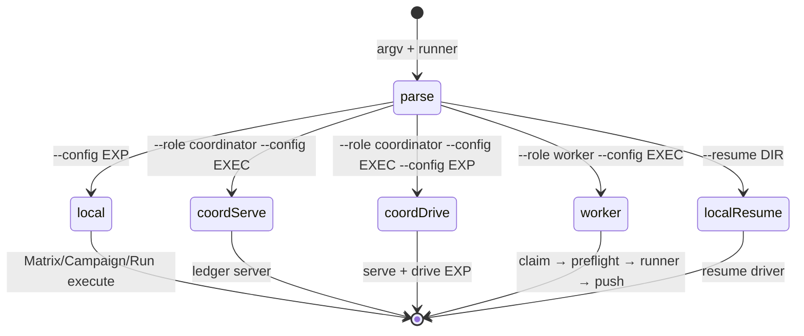

# CLI

Projects attach a runner and call `main(runner)`. Argv selects how **this device** runs; the experiment body (`runner`) is identical for local Runs and worker-claimed Runs.

```
python my_bench.py --config <name|path> [--config <name|path> ...] [options]
```

| Flag / arg | Required when | Meaning |
|---|---|---|
| `--config <name\|path>` (repeatable) | always, except `--resume` alone | Path or bare stem; classified by TOML section / path |
| `--role coordinator \| worker` | optional | Device role; **omit ⇒ local** |
| `--resume <results-dir>` | optional | Resume incomplete run/matrix/campaign (local, or submit resume to coordinator); may omit `--config` |
| `--name <str>` | optional | Override result dir stem (stamp still prefixed) |
| `--cell-id <id>` (repeatable) | optional | Matrix cell filter (local driver or submit) |
| `--phase-id <id>` (repeatable) | optional | Campaign phase filter (local driver or submit); match phase `id` as string |
| `--no-console-log` | optional | Disable console log mirror |

## Classification

`--config` is required for every non-resume launch. Each value is classified:

| Kind | Path heuristic | TOML sections |
|---|---|---|
| Experiment run | under `configs/run/` | exactly `[run]` (no `[matrix]`/`[campaign]`/`[coordinator]`/`[worker]`) |
| Experiment matrix | under `configs/matrix/` | exactly `[matrix]` |
| Experiment campaign | under `configs/campaign/` | exactly `[campaign]` |
| Execution | under `configs/execution/` | `[coordinator]` and/or `[worker]` |

Rules:

1. Path under a known tree wins over section sniffing.
2. If path is outside those trees, classify by sections; **error** if zero or more than one experiment kind, or if both experiment and execution sections appear in one file.
3. Bare stem (no `/` or `\`, optional `.toml`): search `configs/run|matrix|campaign|execution/` (depending on role context) for a unique `stem` or `stem.toml`; **0 or >1 matches → error**.
4. Local mode searches experiment trees only. Worker/coordinator searches `execution/` first for the execution config; the optional second config on coordinator is experiment-only.

## Arity by mode

| Mode | Config arity |
|---|---|
| Local | exactly one experiment |
| Coordinator | exactly one execution; **optional** second config = one experiment to submit/drive on startup |
| Worker | exactly one execution |

Wrong count or ambiguous sections → exit code **1** with message on stderr.

## Role behavior

| Invocation | Behavior |
|---|---|
| `--config EXP` (no `--role`) | Drive `Run` / `MatrixRun` / `CampaignRun` **locally**; `LocalFsLedger`; calls `runner` for each Run |
| `--role coordinator --config EXEC` | Bind ledger server (uvicorn); wait for submits (API or later CLI) |
| `--role coordinator --config EXEC --config EXP` | Bind ledger server **and** drive that matrix/campaign on the coordinator |
| `--role worker --config EXEC` | Claim loop: fetch `RunSpec`, `preflight`, `runner(run)`, push package; **no** matrix/campaign `execute` |
| `--resume DIR` (no `--role`) | Local resume from `DIR` (see [Lifecycle — Resume](lifecycle.md#resume)) |
| `--role coordinator --config EXEC --resume DIR` | `POST /v1/resume` against local server (or drive resume in-process) |



## Exit codes

| Code | Meaning |
|---|---|
| `0` | Success (layer `complete`, or resume no-op on already-terminal success) |
| `1` | Usage / config classification / validation error |
| `2` | Layer finished `failed` |
| `3` | Layer finished `cancelled` |
| `4` | Ledger / network / server error |

## Workspace root

`BENCH_RUN_ROOT` if set, else `Path.cwd()`. All relative config and `bench_run/` paths resolve from this root.

## Examples

```bash
# Local matrix
python my_bench.py --config factor_a.toml

# Local resume
python my_bench.py --resume bench_run/results/campaign/20250101_120000_phased

# Coordinator (serve only)
python my_bench.py --role coordinator --config lab.toml

# Coordinator serve + drive a campaign
python my_bench.py --role coordinator --config lab.toml --config phased.toml

# Worker (runner from this script; work from claims)
python my_bench.py --role worker --config lab.toml
```
