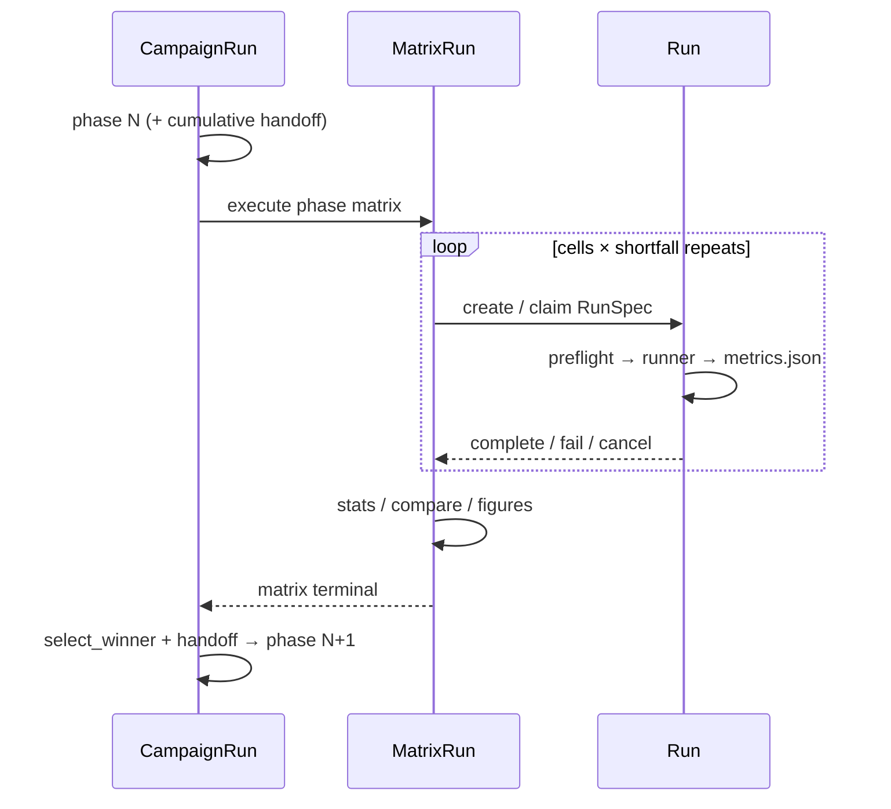
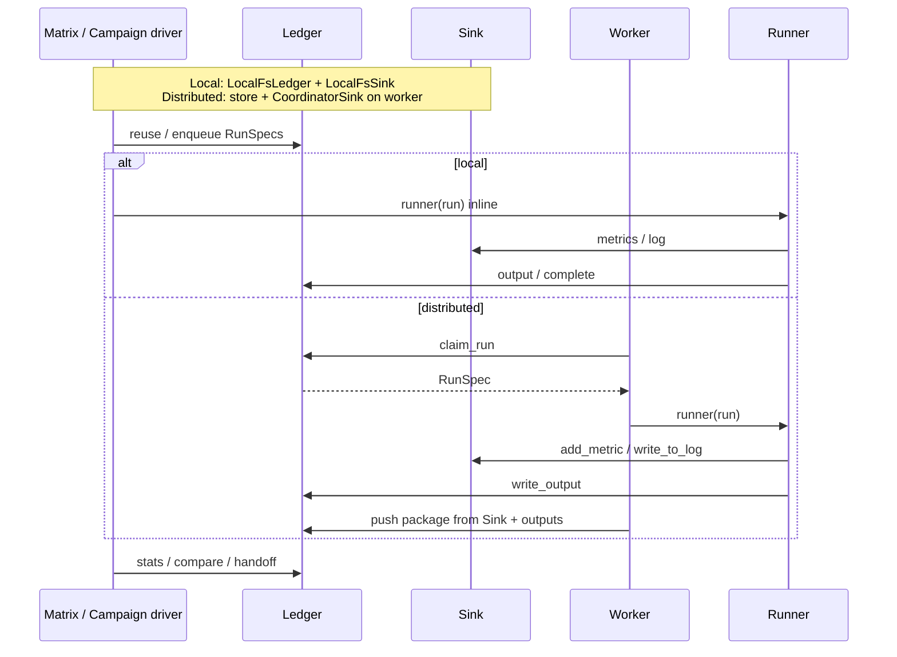

# Concepts

## Hierarchy

| Layer | Role |
|---|---|
| **Run** | Lifecycle, preflight, and observability for one config |
| **MatrixRun** | Ablation grid: cells, repeats, reuse, aggregate, charts |
| **CampaignRun** | Ordered phases; winner metric; `handoff_keys` into the next phase |

## Execution model

The library owns directories, lifecycle, fingerprint reuse, stats/compare/figures, and campaign hand-off. The caller owns the experiment body.

A **runner** is `runner(run) -> None`. It writes metrics under `metrics.run` / `metrics.items` (via `add_metric` / `add_item_metric(s)`), writes outputs under `output/`, and raises on hard failure. Pass the runner into `execute` or `main`; the library does not register named entrypoints.

- Single `Run`: use as a context manager; call the runner (or inline the body) yourself.
- **Local** `MatrixRun.execute(runner)` / `CampaignRun.execute(runner)`: orchestration in-process; creates each shortfall `Run`, runs `Run.preflight`, then `runner(run)`.
- **Distributed:** the **coordinator** drives `MatrixRun` / `CampaignRun` (same modules, shared ledger). **Workers** only claim and execute individual `Run`s — they do not run matrix/campaign `execute`.

## Ledger + Sink injection

- **Ledger** — orchestration: claims, outputs, manifests, stats/compare/figures, winners/handoff, complete/fail packages.
- **Sink** — telemetry: `log.txt`, progress bars/lines, `metrics.json` (see [sink.md](sink.md)).

`Run` helpers route accordingly (`add_metric` / `write_to_log` → Sink; `write_output` / `complete` → Ledger). The runner never branches on role or network.

`main(runner)` selects behavior by `--role`:

| Mode | Backend / process |
|---|---|
| omit `--role` | `LocalFsLedger`; in-process matrix/campaign/run `execute` |
| `--role coordinator` | Serve ledger + **drive** submitted matrix/campaign orchestration (does not call `runner`) |
| `--role worker` | Claim-loop: pull `RunSpec`, build `Run`, preflight, `runner(run)`, push package |

Programmatic callers that skip `main` default to local FS; an explicit ledger can be passed when needed.

| Concern | Local (driver in-process) | Distributed |
|---|---|---|
| Matrix / campaign orchestration | Same process as `runner` | **Coordinator only** |
| Run body + preflight | In-process | **Worker** (local disks / GPUs) |
| Metrics / outputs / log | `LocalFsLedger` files | Worker buffers; push package on `complete` / `fail` / cancel |
| Fingerprint reuse / shortfall | Local scan | Coordinator queries ledger, enqueues one work item per shortfall repeat |
| Matrix stats / compare / figures | Write under matrix dir | Coordinator finalizes when cells are terminal |

**Claim unit:** one **Run** (one repeat). Cell/phase sequencing and handoff stay on the coordinator.

Details: [Artifacts](artifacts.md), [Lifecycle](lifecycle.md), [Ledger](ledger.md), [Package](package.md).

## Behavior

- **Fingerprint reuse.** Completed runs whose fingerprint matches a cell fill repeats before new Runs are enqueued.
- **Fail policy.** Each cell has `max_failures` (default = `repeats`), counted separately from completes. Runtime failures append `failed_run_ids` and enqueue another attempt while `failed < max_failures` and `completed < repeats`. Matrix always continues other cells. Campaign `continue_on_fail` applies to phase matrix failure only; it does not soften preflight cancels.
- **Inline configs.** Dict configs require `name=` or a section `name`; they serialize to `config.toml`.
- **Handoff.** Driver copies `handoff_keys` from the winning cell’s params and pinned artifact files into `handoff.json` + `handoff/<phase_id>/`. Later Runs receive paths via `RunSpec` / `run.handoff_artifacts`. Optional `winner_cell` / `force_cell` overrides metric-based selection.
- **Preflight.** Owned by `Run` on the machine that executes it (local driver or worker): structural defaults plus optional hook/override. See [Lifecycle](lifecycle.md#preflight).
- **Figures.** Matrix charts always attempt after compare; best-effort and non-fatal if matplotlib is missing.
