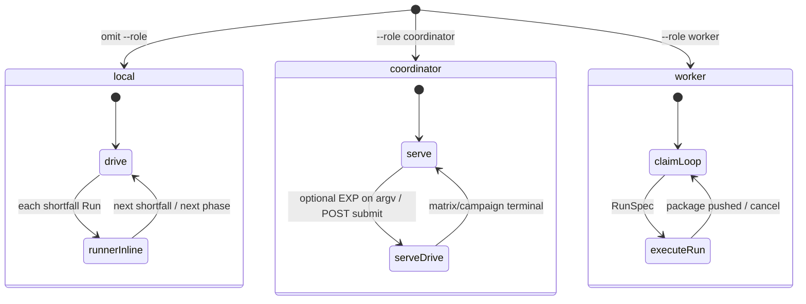
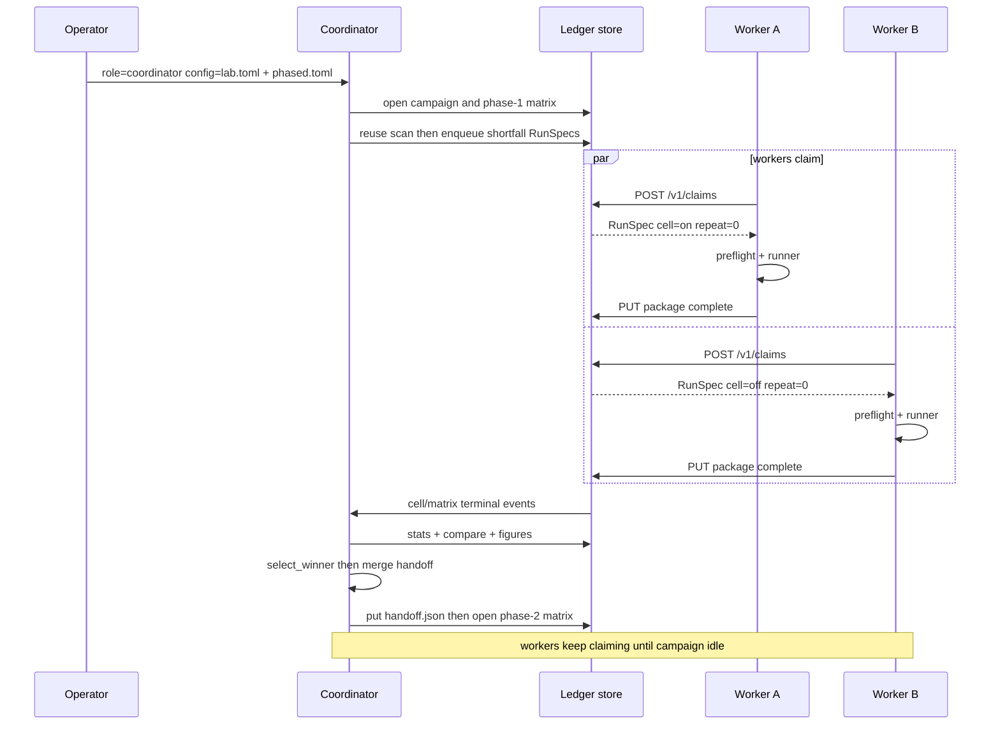

# Distributed execution

Optional **shared ledger** with the **coordinator as the only distributed driver** of `MatrixRun` / `CampaignRun`. Workers claim and execute individual `Run`s, then push packages. Experiment configs stay under `configs/{run,matrix,campaign}/`. Coordinator and worker settings share one TOML under `configs/execution/`.

Protocol, claims, REST: [Ledger](ledger.md). Injection overview: [Concepts](concepts.md#ledger-injection).

## Config — `configs/execution/`

```toml
[coordinator]
name = "lab_cluster"
bind = "0.0.0.0:8443"          # host:port for uvicorn
# data_dir = "results/_coordinator"  # server store root (default)
# auth = { token_env = "BENCH_RUN_TOKEN" }

[worker]
url = "http://coordinator.example:8443"
# auth = { token_env = "BENCH_RUN_TOKEN" }

[worker.claim]
# poll_s = 2.0
# lease_s = 300
# heartbeat_fraction = 3          # heartbeat every lease_s / 3
# matrix_ids = []                 # if non-empty, only claim these
# campaign_ids = []
# config_stems = []
```

| Key | Default | Notes |
|---|---|---|
| `coordinator.bind` | required | `"host:port"`; uvicorn listens here |
| `coordinator.data_dir` | `results/_coordinator` | manifests, run packages, claim db |
| `coordinator.auth.token_env` | unset | if set, require `Authorization: Bearer` matching env value |
| `worker.url` | required for worker | base URL, no trailing slash required (normalize strip) |
| `worker.claim.poll_s` | `2.0` | sleep after HTTP 204 empty claim |
| `worker.claim.lease_s` | `300` | requested lease seconds |
| `worker.claim.heartbeat_fraction` | `3` | interval = `lease_s / fraction` |
| filter lists | empty | empty = no filter; non-empty = claim only if parent ids / stem match |

## Process model

- **Coordinator:** one OS process; uvicorn with **1 worker** (in-process `MatrixRun`/`CampaignRun` driver shares the ledger store memory/FS). Starlette app mounts REST + starts driver tasks on submit. With `--until-done` (+ experiment config), the server exits when that matrix/campaign is terminal.
- **Worker:** one process per machine/GPU slot; single-threaded claim loop (heartbeat on a daemon thread or `asyncio` task). With `--until-done`, exits after `--idle-polls` empty claims, or when the coordinator goes away after work.
- **Local:** no server; `LocalFsLedger` + `LocalFsSink`. Layer `write_to_log` / `progress_line` / `progress_bar` / `add_metric` go through the Sink into `log.txt` / `metrics.json` (TTY bars via `alive-progress`).

## Contract

| Concern | Role |
|---|---|
| **Ledger** | Shared store for runs, manifests, fingerprints, claims |
| **Drive** | Coordinator runs matrix/campaign state machines (reuse, enqueue Runs, winners, handoff, halt policy, stats/compare/figures) |
| **Execute** | Workers claim one Run at a time; preflight + `runner` + push package |
| **Reuse / handoff** | Coordinator-only in distributed mode |
| **Sync** | Workers push run packages on terminal Run status; pull `RunSpec` from claims |
| **Handoff files** | Coordinator copies pins into `campaign_dir/handoff/…`; workers download via paths in `RunSpec` before `runner` |

Without `--role`, orchestration stays on `LocalFsLedger`. The same `MatrixRun` / `CampaignRun` modules run in-process locally or inside the coordinator process; workers never call matrix/campaign `execute`.

## Role state



## Worker loop (normative)

1. `POST /v1/claims` with `{worker_id, lease_s, filters?}`.
2. On **204**: sleep `poll_s`; goto 1.
3. On **200** `RunSpec`: create working dir under `results/run/<run_id>/` (or temp under worker data); write `config.toml` from spec; materialize `handoff_artifacts` into `run_dir/handoff/`.
4. Start heartbeat task (`lease_s / heartbeat_fraction`).
5. `Run.preflight()`; on cancel → `POST …/cancel`, stop heartbeat, `DELETE` claim, goto 1.
6. `runner(run)`; on success `complete()` → `PUT …/package`; on exception `fail()` → `PUT …/package`.
7. Stop heartbeat; `DELETE` claim (best-effort); goto 1.
8. On lease loss mid-run: stop runner if possible; **do not** count as complete; coordinator re-queues spec; worker exits attempt and loops.

`worker_id` default: `socket.gethostname() + ":" + str(os.getpid())`.

## Distributed campaign walkthrough



See [Lifecycle](lifecycle.md) for cell/phase state machines and [Ledger](ledger.md) for claim leases and aggregation triggers.
