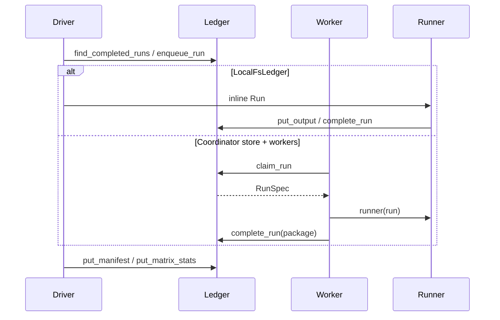
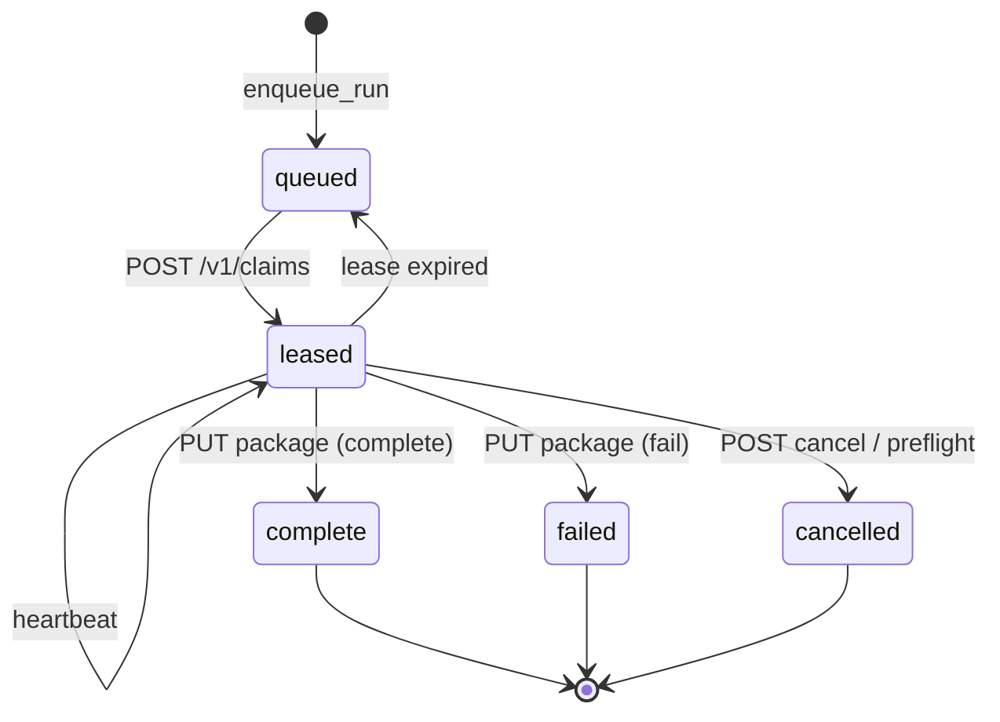
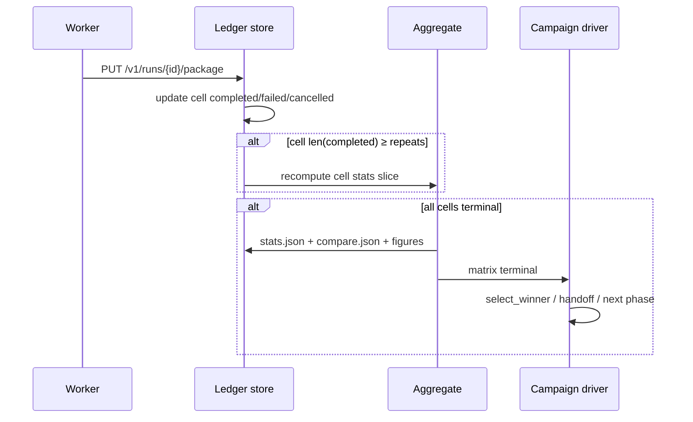

# Ledger protocol and REST

One **Ledger** interface backs local and distributed modes. See [Concepts — Ledger injection](concepts.md#ledger-injection).

Coordinator HTTP stack: **Starlette** + **uvicorn**.

## Ownership

| Concern | Local | Distributed |
|---|---|---|
| Matrix / campaign state machine | In-process driver | **Coordinator** |
| Run preflight + `runner` | In-process | **Worker** |
| Run package storage | `results/` | Coordinator store (worker keeps working copy) |
| Enqueue / shortfall / reuse | Driver | Coordinator |
| Matrix stats / compare / figures | Driver writes files | Coordinator finalizes when cells terminal |
| Claim | N/A (inline Runs) | One **Run** (one repeat) per claim |



## Auth

- Bearer token from env: execution config `auth.token_env` (e.g. `BENCH_RUN_TOKEN`). Client and server read `os.environ[token_env]`.
- Request header: `Authorization: Bearer <token>`.
- If auth is configured on the server and the header is missing or wrong → **401** with error JSON.
- If auth is unset on the server → open (no check).
- Same rule for all `/v1/*` routes; `/health` stays unauthenticated.

## Error JSON

All non-2xx API errors (except empty **204**):

```json
{ "error": "code", "message": "…" }
```

| `error` | Typical use |
|---|---|
| `unauthorized` | 401 missing/wrong Bearer |
| `not_found` | 404 unknown id |
| `conflict` | 409 conflicting terminal status / lease |
| `validation_error` | 400 bad body / multipart |
| `gone` | 410 claim expired |

## RunSpec (claim payload)

```json
{
  "run_id": "20250101_120000_baseline",
  "claim_id": "…",
  "config_stem": "baseline",
  "config_toml": "…",
  "params": { },
  "fingerprint": "sha256:…",
  "handoff_artifacts": {
    "model": {
      "path": "handoff/1/model",
      "sha256": "…"
    }
  },
  "parent": {
    "layer": "matrix",
    "id": "20250101_110000_factor_a",
    "cell_id": "on",
    "repeat_index": 2
  },
  "lease_s": 300
}
```

| Field | Notes |
|---|---|
| `handoff_artifacts` | Map stem → `{ "path", "sha256" }`. `path` is relative to the campaign result dir on the coordinator, or an absolute/URL path the worker can fetch. Empty object when none. |
| `lease_s` | Seconds; default **300** if omitted at enqueue. |

Experiment identity travels in the claim; workers do not need an experiment `--config` on argv.

Worker download: before `runner`, fetch each artifact into `run_dir/handoff/<stem>` (preserve source extension when writing the local file if the stem path has none — use Content-Type / source filename). Expose `run.handoff_artifacts` as a map stem → **local filesystem path**.

## Schemas

### RunPackage

Logical contents for `complete_run` / `fail_run` / `PUT …/package`:

```json
{
  "metadata": {
    "status": "complete",
    "fingerprint": "sha256:…",
    "error": null,
    "pins": { "model": "output/model.pt" }
  },
  "metrics": {
    "run": { "accuracy": 0.8 },
    "items": { }
  },
  "config_toml": "…",
  "log": "…",
  "artifacts": [
    { "relative_path": "output/model.pt", "content_type": "application/octet-stream" }
  ]
}
```

| Field | Required on PUT | Notes |
|---|---|---|
| `metadata` | yes | Must include terminal `status`: `complete` \| `failed` \| `cancelled`. Optional `error` string on fail. Optional `pins` stem → relative_path from `pin_artifact`. |
| `metrics` | for `complete` | May be `{}` on fail/cancel. |
| `config_toml` | recommended | Snapshot text. |
| `log` | recommended | Full or tail log text. |
| `artifacts` | optional | Binary parts keyed by `relative_path`. |

### RunRecord

Returned by `get_run` / `GET /v1/runs/{run_id}`:

```json
{
  "run_id": "20250101_120000_baseline",
  "status": "complete",
  "fingerprint": "sha256:…",
  "config_stem": "baseline",
  "params": { },
  "parent": {
    "layer": "matrix",
    "id": "20250101_110000_factor_a",
    "cell_id": "on",
    "repeat_index": 2
  },
  "claim_id": null,
  "lease_expires_at": null,
  "error": null,
  "created_at": "2025-01-01T12:00:00Z",
  "updated_at": "2025-01-01T12:05:00Z",
  "finished_at": "2025-01-01T12:05:00Z",
  "package_present": true
}
```

### RunHandle

Returned by `create_run` (local or server):

```json
{
  "run_id": "20250101_120000_baseline",
  "dir": "bench_run/results/run/20250101_120000_baseline",
  "status": "running"
}
```

`dir` is the working result directory (local absolute or coordinator-store relative path).

## Multipart package — `PUT /v1/runs/{run_id}/package`

- **Content-Type:** `multipart/form-data`
- Terminal status is taken from the `metadata` JSON part’s `status` field (`complete` \| `failed` \| `cancelled`).

| Part name | Content-Type | Body |
|---|---|---|
| `metadata` | `application/json` | RunPackage `metadata` object (JSON) |
| `metrics` | `application/json` | metrics object (JSON); may be `{}` |
| `config_toml` | `text/plain` | config snapshot text |
| `log` | `text/plain` | log text |
| `artifact` | file octet-stream | **Repeatable.** Each part’s `Content-Disposition` **filename** = artifact `relative_path` (e.g. `output/model.pt`). |

Example disposition for an artifact part:

```http
Content-Disposition: form-data; name="artifact"; filename="output/model.pt"
Content-Type: application/octet-stream
```

Missing optional parts: treat as empty. Unknown part names → **400** `validation_error`.

### Idempotent PUT rules

| Current store status | Incoming `metadata.status` | Result |
|---|---|---|
| same terminal (`complete`/`failed`/`cancelled`) | same terminal | **200** no-op (body may echo current `RunRecord`) |
| terminal A | terminal B ≠ A | **409** `conflict` |
| `running` / leased / queued unpackaged | any terminal | accept; store package; update cell aggregates |
| unknown `run_id` | any | **404** |

## Cancel — `POST /v1/runs/{run_id}/cancel`

Body:

```json
{ "reason": "…" }
```

Marks the Run `cancelled` (preflight or explicit). Updates cell/phase cancel dominance per [Lifecycle](lifecycle.md). Idempotent if already `cancelled` → **200**. Conflicting other terminal → **409**.

## POST matrices / campaigns

### `POST /v1/matrices`

```json
{
  "config_toml": "…",
  "name": "optional_override",
  "cell_ids": ["on", "off"],
  "resume_dir": null
}
```

Or path reference instead of inline TOML:

```json
{
  "config_path": "bench_run/configs/matrix/factor_a.toml",
  "name": null,
  "cell_ids": null,
  "resume_dir": null
}
```

| Field | Notes |
|---|---|
| `config_toml` \| `config_path` | Exactly one required (unless `resume_dir` alone resumes an existing matrix). |
| `name` | Optional stamp stem override. |
| `cell_ids` | Optional filter; `null`/omit = all cells. |
| `resume_dir` | Optional existing matrix result dir (store-relative or absolute under data dir). |

Response **201**: `{ "matrix_id": "20250101_110000_factor_a" }`.

### `POST /v1/campaigns`

```json
{
  "config_toml": "…",
  "name": null,
  "phase_ids": [1, 2],
  "resume_dir": null
}
```

Or `config_path` instead of `config_toml`. `phase_ids` filters phases; omit = all.

Response **201**: `{ "campaign_id": "20250101_100000_phased" }`.

### `POST /v1/resume`

```json
{
  "results_dir": "results/campaign/20250101_100000_phased"
}
```

Or `{ "layer_id": "20250101_100000_phased" }` when the id is unique in the store.

Reopens matrix or campaign driver from manifest shortfall / remaining phases. Response **200**: `{ "layer": "campaign"|"matrix", "id": "…" }`. Already terminal `complete`/`cancelled` → **200** no-op. Unknown → **404**.

## Claim filters

`POST /v1/claims` body:

```json
{
  "worker_id": "host-a",
  "lease_s": 300,
  "filters": {
    "matrix_ids": ["20250101_110000_factor_a"],
    "campaign_ids": [],
    "fingerprint_prefixes": ["sha256:abcd"],
    "tags": ["gpu"]
  }
}
```

| Field | Notes |
|---|---|
| `worker_id` | Required. |
| `lease_s` | Optional; default **300**. Overrides spec default for this claim. |
| `filters` | Optional. All present filter keys are AND. Empty lists mean no restriction on that key. Omit `filters` → any queued Run. |
| `filters.tags` | Reserved; v1 always empty (no tag attach at enqueue). |

**204** when queue empty (no body). Worker sleeps `claim.poll_s` (execution `[worker.claim] poll_s`, default **2.0** seconds) then polls again.

## Lease and heartbeat

- Claim unit = **one Run** (one shortfall repeat).
- Default `lease_s` = **300**.
- Heartbeat interval on worker: every `lease_s / 3`.
- `POST /v1/claims/{claim_id}/heartbeat` extends the lease to **now + lease_s** (the claim’s lease duration).
- Coordinator lease-expiry scan interval: default **10** seconds (config `[coordinator].lease_scan_s`).
- Expired claim → RunSpec re-queued; unpackaged Runs do not count as complete; clear `claim_id` / `lease_expires_at`.
- `DELETE /v1/claims/{claim_id}` releases without completing (re-queue if still non-terminal).



## Aggregation trigger

On each terminal Run package (or cancel) for `(matrix_id, cell_id)`:

1. Update manifest ids/status (`completed_run_ids` / `failed_run_ids` / cancel). See [Lifecycle — shortfall](lifecycle.md#matrix-algorithm-driver).
2. If cell `len(completed_run_ids) >= repeats`, recompute that cell’s stats slice.
3. If all cells terminal, build full `stats.json`, `compare.json`, figures; signal matrix terminal waiters; campaign driver may `select_winner` / handoff / open next phase.

### Driver wait (matrix terminal)

- **In-process** (LocalFsLedger or coordinator driver sharing the server store): `await` / wait on an `asyncio.Event` (or `threading.Event`) keyed by `matrix_id`. Store sets the event when the matrix becomes terminal.
- **Out-of-process** client: poll `GET …/manifest` every **1** s until all cells terminal, or use `wait_matrix_terminal` which blocks on the same event when the ledger is co-located.



## Ledger protocol (Python)

```python
class Ledger(Protocol):
    # Runs
    def create_run(self, spec: RunSpec) -> RunHandle: ...
    def put_output(self, run_id: str, relative_path: str, data: bytes) -> None: ...
    def complete_run(self, run_id: str, package: RunPackage | None = None) -> None: ...
    def fail_run(self, run_id: str, error: str, package: RunPackage | None = None) -> None: ...
    def cancel_run(self, run_id: str, reason: str = "") -> None: ...
    def get_run(self, run_id: str) -> RunRecord: ...

    # Fingerprints / reuse
    def find_completed_runs(self, fingerprint: str, *, limit: int) -> list[str]: ...

    # Matrix
    def get_manifest(self, layer_id: str) -> dict: ...
    def put_manifest(self, layer_id: str, manifest: dict) -> None: ...
    def put_matrix_stats(self, matrix_id: str, stats: dict) -> None: ...
    def put_matrix_compare(self, matrix_id: str, compare: dict) -> None: ...
    def put_matrix_figure(self, matrix_id: str, name: str, png: bytes) -> None: ...
    def wait_matrix_terminal(self, matrix_id: str, *, timeout_s: float | None = None) -> dict: ...
    # wait_matrix_terminal: block until matrix terminal; return manifest.
    # Local/coordinator: Event. Remote client: poll manifest every 1s.

    # Campaign
    def put_campaign_manifest(self, campaign_id: str, manifest: dict) -> None: ...
    def put_winners(self, campaign_id: str, winners: dict) -> None: ...
    def put_handoff(self, campaign_id: str, handoff: dict) -> None: ...
    def get_handoff(self, campaign_id: str) -> dict: ...
    def put_handoff_artifact(
        self, campaign_id: str, phase_id: str | int, stem: str, data: bytes, *, filename: str
    ) -> str: ...
    # returns store-relative path under campaign_dir/handoff/<phase_id>/<stem>

    # Work queue (distributed)
    def enqueue_run(self, spec: RunSpec) -> None: ...
    def claim_run(
        self, *, worker_id: str, lease_s: int = 300, filters: dict | None = None
    ) -> RunSpec | None: ...
    def heartbeat_claim(self, claim_id: str) -> None: ...
    def release_claim(self, claim_id: str) -> None: ...
```

`LocalFsLedger`: filesystem under `bench_run/results/`; `enqueue_run` / `claim_run` unused (driver runs inline). `wait_matrix_terminal` returns immediately after in-process drive updates.

`CoordinatorLedger` (worker client): buffers outputs; reads log/metrics from the injected `CoordinatorSink` (or disk) when building packages; `complete_run` / `fail_run` / `cancel_run` upload multipart; implements `claim_run` / heartbeats. Handoff download via GET handoff + artifact paths in `RunSpec`.

Coordinator **server store** implements the same protocol for the in-process driver hosted in the server.

## REST API (coordinator)

Base URL from `[worker].url`. Auth: `Authorization: Bearer <token>` when configured.

| Method | Path | Body / result |
|---|---|---|
| `GET` | `/health` | `{ "ok": true }` |
| `POST` | `/v1/matrices` | submit/drive matrix → `{ "matrix_id" }` |
| `POST` | `/v1/campaigns` | submit/drive campaign → `{ "campaign_id" }` |
| `POST` | `/v1/resume` | `{ "results_dir" }` or `{ "layer_id" }` → `{ "layer", "id" }` |
| `GET` | `/v1/matrices/{matrix_id}/manifest` | manifest JSON |
| `GET` | `/v1/matrices/{matrix_id}/stats` | stats JSON |
| `GET` | `/v1/matrices/{matrix_id}/compare` | compare JSON |
| `GET` | `/v1/campaigns/{id}/manifest` | manifest JSON |
| `GET` | `/v1/campaigns/{id}/handoff` | handoff JSON |
| `GET` | `/v1/campaigns/{id}/winners` | winners JSON |
| `GET` | `/v1/campaigns/{id}/stats` | **N/A** → **404** `{ "error": "not_found", "message": "campaigns have no stats" }` |
| `GET` | `/v1/runs/{run_id}` | `RunRecord` |
| `PUT` | `/v1/runs/{run_id}/package` | multipart package; status from metadata |
| `POST` | `/v1/runs/{run_id}/cancel` | `{ "reason": "…" }` |
| `GET` | `/v1/fingerprints/{fingerprint}/runs?limit=N` | `{ "run_ids": [...] }` (`complete` only) |
| `POST` | `/v1/claims` | worker_id, lease_s, filters → `RunSpec` or **204** |
| `POST` | `/v1/claims/{claim_id}/heartbeat` | extend lease by `lease_s` from now |
| `DELETE` | `/v1/claims/{claim_id}` | release (re-queue if non-terminal) |
| `GET` | `/v1/artifacts/{path}` | download store file (handoff artifacts, figures); path relative to data dir |

### REST parity (local Ledger method → HTTP)

| Ledger method | HTTP |
|---|---|
| `get_manifest` (matrix) | `GET /v1/matrices/{id}/manifest` |
| `put_manifest` | internal store (driver on server) |
| `put_matrix_stats` / compare / figure | internal; readable via GET stats/compare/artifacts |
| `get_manifest` (campaign) | `GET /v1/campaigns/{id}/manifest` |
| `put_campaign_manifest` | internal |
| `get_handoff` / `put_handoff` | `GET /v1/campaigns/{id}/handoff` (PUT internal) |
| `put_winners` | internal; `GET /v1/campaigns/{id}/winners` |
| `wait_matrix_terminal` | poll manifest every 1s or in-process Event |
| `find_completed_runs` | `GET /v1/fingerprints/{fp}/runs` |
| `claim_run` / heartbeat / release | `POST /v1/claims`, heartbeat, `DELETE` |
| `complete_run` / `fail_run` | `PUT /v1/runs/{id}/package` |
| `cancel_run` | `POST /v1/runs/{id}/cancel` |
| campaign stats | N/A |

## Server store on-disk layout

Coordinator data dir (`[coordinator].data_dir`, default under process cwd or configured path):

```
<data_dir>/
  runs/<run_id>/
    metadata.json
    metrics.json
    config.toml
    log.txt
    output/                    # artifact relative_paths
  matrices/<matrix_id>/
    metadata.json
    config.toml
    manifest.json
    stats.json
    compare.json
    figures/*.png
  campaigns/<campaign_id>/
    metadata.json
    config.toml
    manifest.json
    winners.json
    handoff.json
    handoff/<phase_id>/<stem>  # pinned files; extension preserved from source
  fingerprints/<fingerprint_hex>/runs.json   # list of complete run_ids
  queue/
    pending.jsonl              # or equivalent claim queue state
    leases.json                # claim_id → expiry, run_id, worker_id
```

`handoff.json` artifact entries store paths **relative to the campaign dir** (e.g. `handoff/1/model.pt`). RunSpec `handoff_artifacts[].path` uses the same relative form (workers resolve via coordinator GET) or a full URL.
