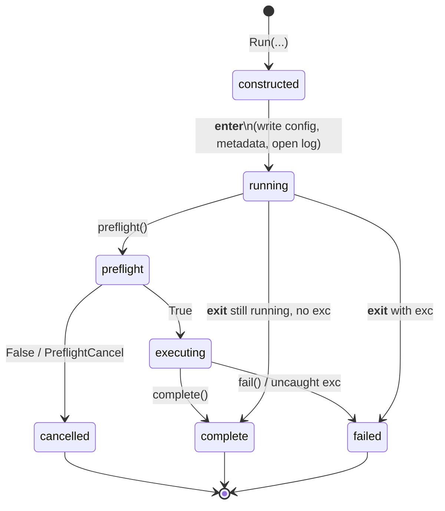
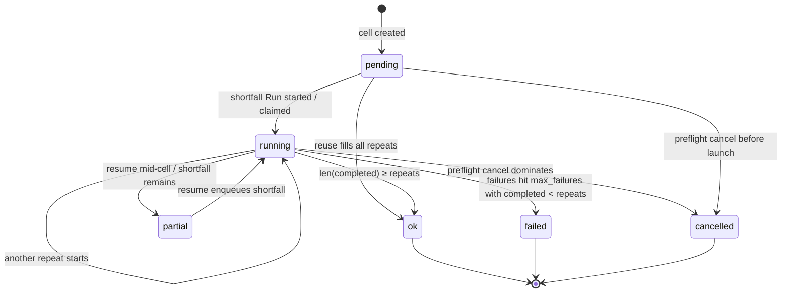
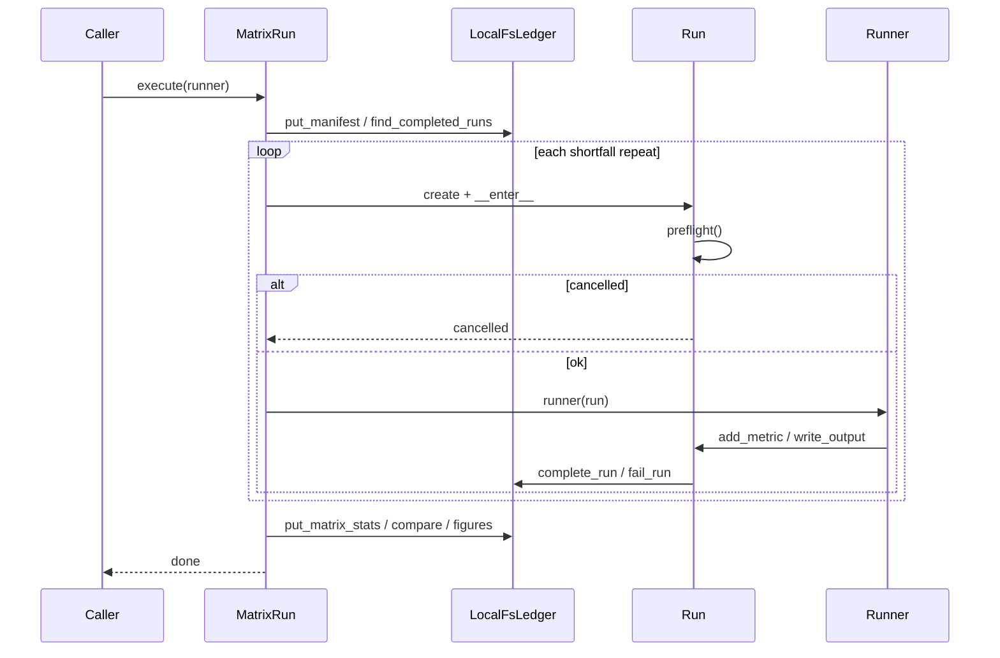
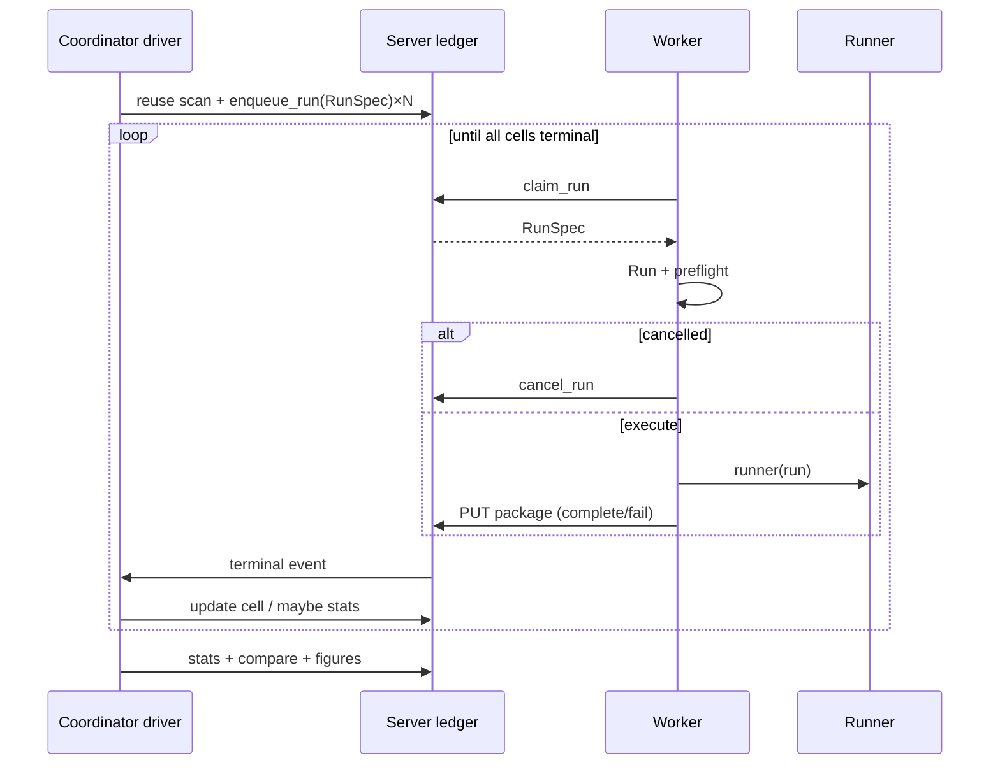
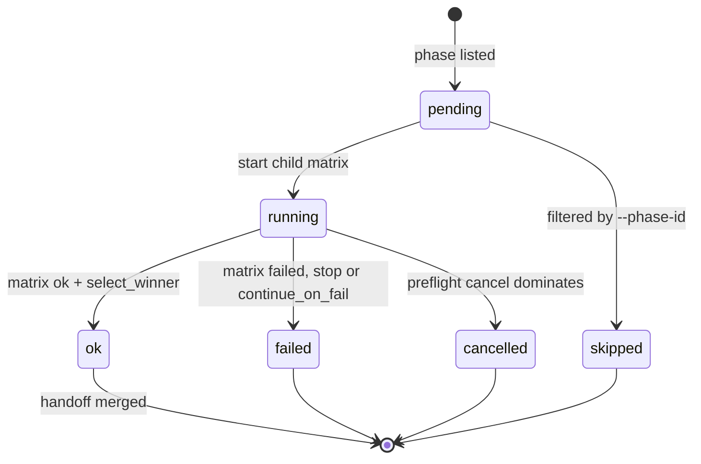
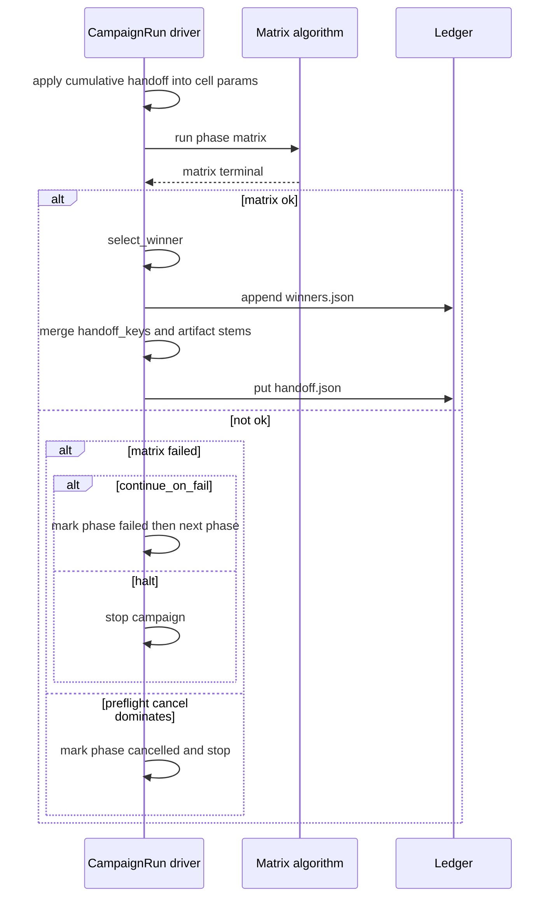
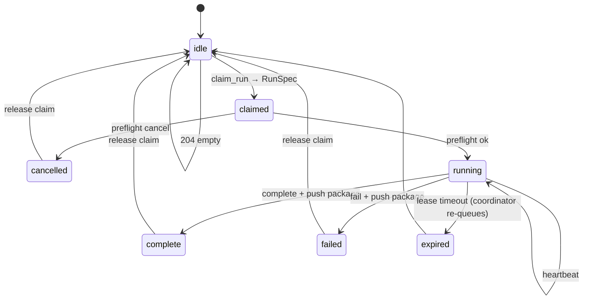

# Lifecycle

## Stamp / id format

Result directory ids: `YYYYMMDD_HHMMSS_<stem>` in **UTC**.

- `<stem>` from config `name` or file stem.
- On collision with an existing dir under the same layer: append `_N` (`_2`, `_3`, …) until unique.
- Same format for Run, Matrix, and Campaign ids.

## Run lifecycle



| Step | Who |
|---|---|
| Create working dir, write `config.toml`, `metadata.json` (`running`), open `log.txt` | `Run.__enter__` |
| `preflight()` / `check_config()` | Machine that executes the Run: local driver or **worker** |
| Call `runner(run)` | Local `execute` or worker claim loop |
| `complete()` / `fail()` | Same; pushes package when using `CoordinatorLedger` |
| Context `__exit__` with no terminal status | Treat as `fail` if exc, else `complete` if still `running` |

`add_metric` / `write_output` / `write_to_log` / `pin_artifact` are valid only while `status == running`.

### `pin_artifact`

`run.pin_artifact(stem, relative_path)` records `stem → relative_path` in Run metadata `pins` (and may mirror under metrics metadata). On campaign phase win, the driver copies those pinned files from the winning run package into handoff storage (see [Handoff](#handoff)).

## Preflight

Owned by `Run` on the **executing** machine (needs local `data.root`, GPUs, hooks).

**Default `check_config` (structural):**

1. Config parses as TOML and resolves to a run config.
2. Required fields present: section `name` (or constructor `name=`).
3. If `[data].root` is set, the path exists (relative to `bench_run/` or absolute).
4. For matrix/campaign **submit** on the driver: referenced cell/phase config stems resolve to exactly one file (checked at orchestration start, not on the worker).

**Cancel:** `preflight()` returns `False` or raises `PreflightCancel`. No `runner` call. Worker reports `cancelled` for that Run; coordinator marks the cell/phase accordingly.

### Preflight cancel dominance

Any preflight cancel on a cell in a phase → that cell `cancelled`, the phase `cancelled`, **no** winner selection, **no** handoff merge for that phase, and the **campaign stops**. `continue_on_fail` is ignored for preflight cancels. Other in-flight cells may still finish recording, but the phase and campaign do not proceed to a win path.

**Extension:** override `Run.check_config`, or pass `preflight_hook(run) -> bool` (default checks then hook).

## Who drives matrix / campaign

| Mode | Driver | Executes `runner` |
|---|---|---|
| Local (`LocalFsLedger`) | In-process `MatrixRun` / `CampaignRun` | Same process |
| Distributed | **Coordinator** (same modules, server-side ledger) | **Workers** only |

Workers never call `MatrixRun.execute` / `CampaignRun.execute`.

## Matrix cell state



### Failure / retry policy

- Separate capped failure counter; default **`max_failures = repeats`**, overridable via `[matrix].max_failures`. When a campaign drives a phase, `[campaign].max_failures` overrides the child matrix if set; otherwise the child matrix value applies.
- A **failed** attempt appends to `failed_run_ids` and increments the failure counter. It does **not** count toward `completed_run_ids`.
- Cell becomes **`failed`** when `len(failed_run_ids) >= max_failures` **and** `len(completed_run_ids) < repeats`.
- Replacement attempts: after each failure, if `failed < max_failures` and `completed < repeats` and not cancelled, enqueue **one** new attempt (do not batch-replace).

## Matrix algorithm (driver)

Runs locally in-process or inside the coordinator:

1. Load matrix config; create/open matrix result; write `metadata.json` + `manifest.json`. Read `repeats` and `max_failures` (default `max_failures = repeats`; apply campaign override when hosted by a phase).
2. **Discover / reuse:** for each cell (optional `cell_ids` filter), compute fingerprint; query ledger for completed Runs; attach up to `repeats` into `completed_run_ids` / `reused_run_ids`.
3. **Initial enqueue:** let `in_flight` be queued+leased count for the cell.  
   `to_enqueue = repeats - len(completed_run_ids) - in_flight`  
   Create that many `RunSpec`s / inline Runs (params, parent ids, fingerprint).  
   - **Local:** driver creates each `Run`, preflight, `runner`, finalize sequentially (or with bounded concurrency later; v1 sequential).  
   - **Distributed:** enqueue specs; driver waits until cell/matrix terminal (in-process Event per `matrix_id`, or poll manifest every **1** s).
4. **On each terminal Run:**  
   - **complete:** append to `completed_run_ids`.  
   - **fail:** append to `failed_run_ids` only. If `failed < max_failures` and `completed < repeats` and not cancelled → enqueue **exactly one** replacement.  
   - **cancel (preflight):** append to `cancelled_run_ids`; cell → `cancelled`; no further enqueue for that cell.  
   - **Stop all enqueue** for the cell when `completed >= repeats` **OR** `failed >= max_failures` **OR** `cancelled`.  
   - Continue other cells independently.
5. **Cell status:**  
   - `ok` if `completed >= repeats`  
   - `failed` if `failed >= max_failures` and `completed < repeats`  
   - `cancelled` if preflight cancel  
   - `partial` if resume mid-cell with shortfall remaining and not failed/cancelled  
   - else `running` / `pending`
6. When all cells terminal: write `stats.json`, `compare.json`, figures (local FS or coordinator store).

### Local matrix drive



### Distributed matrix drive



**Distributed driver wait:** when the store is in-process with the driver, wait on an `asyncio.Event` / `threading.Event` per `matrix_id`. Otherwise poll the matrix manifest every **1** s until all cells are terminal.

## Campaign phase state



## Campaign algorithm (driver)

1. Create/open campaign; `manifest.json` with phases.
2. For each phase in order (optional `--phase-id` filter):
   - Apply cumulative `handoff.json` onto phase matrix cell params (see [Handoff](#handoff)).
   - Run matrix algorithm for that phase’s matrix (`max_failures` from that matrix config).
   - On matrix success: `select_winner`; append `winners.json`; merge `handoff_keys` + pinned artifact stems into cumulative handoff; copy artifact files.
   - On matrix failure: if `continue_on_fail`, mark phase `failed` and continue; else **stop campaign**.
   - On preflight cancel dominating a phase: mark phase `cancelled`; **do not** apply `continue_on_fail`; **stop campaign**; no winner/handoff for that phase.
3. Write final `handoff.json` / `winners.json`.

### `select_winner`

Among cells with status **`ok`**, pick by `winner_metric` **mean** from matrix `stats.json`, direction `max` or `min` (`winner_direction`).

- Ties → **first** cell in **config order**.
- Phase `winner_cell` / `force_cell` overrides metric selection (must refer to an `ok` cell; otherwise treat as phase failed).
- If **no** `ok` cells → phase **failed** (no handoff).

### Phase → handoff sequence



## Distributed Run claim (worker)



1. `claim_run()` → `RunSpec` or empty (**204**). On empty, sleep `claim.poll_s` (default **2.0** s), loop.
2. Build `Run` from spec (params already include campaign handoff merge). Download `handoff_artifacts` into `run_dir/handoff/<stem>`; set `run.handoff_artifacts` to local paths.
3. `preflight`; on cancel → report cancelled, release claim, loop.
4. Start heartbeat task; `runner(run)`; `complete` / `fail` → upload run package; release claim.
5. Expired lease → coordinator re-enqueues the spec; worker must not count the Run complete locally if push is rejected.

### Heartbeat

- Background thread or async task every **`lease_s / 3`**.
- Each successful heartbeat extends the lease to now + `lease_s` on the coordinator.
- On heartbeat HTTP failure: log and continue.
- If the lease would expire (local clock past expected expiry without a successful heartbeat): fail the run locally; try **`fail_run` once** while still possibly leased; on **409** / **401** abandon push and exit the claim; do not retry forever.

## Resume

### Matrix / campaign

`Layer.resume(results_dir)` or CLI `--resume`:

1. Load `metadata.json` + config snapshot + manifest.
2. No-op success (exit 0) if layer already terminal `complete` or `cancelled`.
3. Rebuild shortfall from manifest (`completed_run_ids` / `failed_run_ids` / `max_failures`); skip `ok` phases; restore `handoff.json`.
4. **Local:** re-enter driver algorithm from remaining shortfall/phases.
5. **Distributed:** `POST /v1/resume` with `{ "results_dir" }` or `{ "layer_id" }`; workers only see new claims.

CLI `--resume` may omit `--config`; layer from `metadata.layer` / path.

### Bare Run resume

| Current `metadata.status` | CLI `--resume` / `Run.resume` |
|---|---|
| `running` (interrupted crash) | Reopen dir; set status `running` again; caller must invoke `runner` (library does **not** auto-call runner). |
| `complete` | No-op success (exit **0**). |
| `cancelled` | No-op success (exit **0**). |
| `failed` | No-op success (exit **0**). A new attempt is **not** automatic; start a new Run dir to retry. |

Only an interrupted **`running`** Run is resumed. Terminal Run resume does not create a new attempt.

## Fingerprint

**Purpose:** reuse completed Runs as repeats when experiment identity matches.

**Canonical payload** then `json.dumps(payload, sort_keys=True, separators=(",",":"), ensure_ascii=True)` (Python default float formatting: shortest round-trip; same as `json.dumps` default).

```json
{
  "config_stem": "baseline",
  "params": { },
  "fingerprint_fields": { }
}
```

### Canonicalization rules

1. Recursively **sort object keys** at every level.
2. `params` values: JSON types only (`object`, `array`, `string`, `number`, `boolean`, `null`).
3. **Floats:** encode with Python `json` default (shortest round-trip). Reject **NaN** / **±Infinity** at fingerprint time (validation error; do not hash).
4. **Bools:** JSON `true` / `false`.
5. **Lists:** order preserved.
6. **`fingerprint_fields`:** subset of `params` named by `[run].fingerprint_keys` (plus any constructor extras). Keys listed in `fingerprint_keys` but **missing** from `params` → **omit** from the `fingerprint_fields` object (empty object if none match).
7. Do not invent keys; `None`/missing keys are omitted from `fingerprint_fields`, not stored as `null`, unless the key exists in `params` with value `null`.

| Part | Source |
|---|---|
| `config_stem` | Stem of the run config (or inline `name`) |
| `params` | Full `[params]` **after** campaign handoff merge |
| `fingerprint_fields` | Optional `[run].fingerprint_keys` subset, or constructor extras |

**Hash:** `sha256:` + hex digest. Stored on Run `metadata.fingerprint` and on the cell in the matrix manifest.

**Match:** reuse iff fingerprint equality and Run `status == complete`.

## Handoff

Performed by the **campaign driver** (local process or coordinator) after a phase wins:

1. `select_winner` (see above).
2. Read winning cell’s resolved `[params]` (post prior handoff).
3. For each key in phase `handoff_keys`: copy value into cumulative `handoff.params` (and `by_phase[phase_id].params`).
4. **Artifact copy:** for each stem pinned via `run.pin_artifact` on a completed run of the winning cell (or declared in `[run].handoff_artifacts` and present in that run’s `pins` / outputs), copy file bytes into  
   `campaign_dir/handoff/<phase_id>/<stem>`  
   preserving the **source file extension** (e.g. source `output/model.pt` → `handoff/1/model.pt`). Prefer the winning cell’s first completed run that has the pin; if multiple pins for the same stem, last write in pin order wins.
5. Record in `handoff.json` under `artifacts` / `by_phase`: stem → **relative path under the campaign dir** (e.g. `handoff/1/model.pt`).
6. Persist `handoff.json` via ledger `put_handoff`.
7. **Later phases — merge order:**  
   - `params = merge(cell_params, handoff.params)` with **handoff winning** on key collision.  
   - Apply **before** fingerprinting and enqueue.  
   - Build `RunSpec.handoff_artifacts` as map stem → `{ "path": "<relative or URL path>", "sha256": "…" }` from cumulative handoff artifact files.  
   - Workers download into `run_dir/handoff/<stem>` and expose `run.handoff_artifacts` as local paths.

`winner_cell` / `force_cell` override metric-based selection only.
